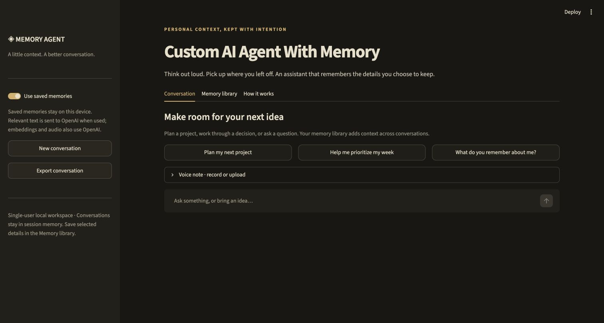
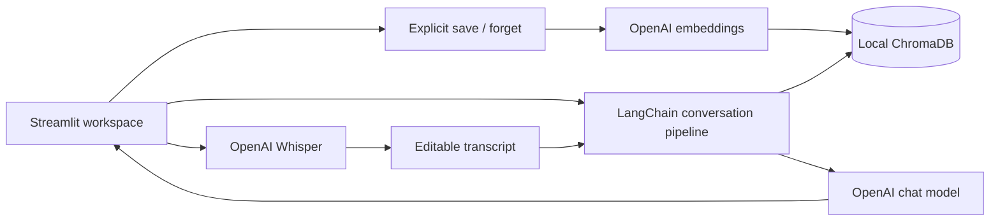

# Custom AI Agent With Memory

A personal voice and text assistant with a persistent, inspectable memory library. Keep selected preferences and project context, start fresh conversations, and retrieve relevant details without saving every chat message.

**Python · LangChain · OpenAI · Whisper · ChromaDB · Streamlit**



[](https://github.com/Abhinav-tanwar/Custom-AI-Agent-With-Memory/actions/workflows/test.yml)

## Features

- Text conversations with bounded recent history and semantic memory retrieval.
- Voice recording and audio upload, transcribed by Whisper into an editable draft.
- Explicit memory creation, duplicate detection, individual deletion, and confirmed bulk deletion.
- Visible context sources on each answer, optional memory retrieval, and JSON exports.
- Warm charcoal, ivory, and amber workspace designed for focused conversations.
- Local persistent vector storage; private configuration and runtime data excluded from Git.

## Run locally

Requires Python 3.12 and an OpenAI API key with API billing enabled.

```bash
python3.12 -m venv .venv
source .venv/bin/activate
pip install -r requirements.txt
cp .env.example .env
# Set OPENAI_API_KEY in .env using a local editor.
streamlit run app.py
```

Open http://127.0.0.1:8030. On macOS, `Start Custom AI Agent.command` starts an existing environment. Never commit `.env` or the `data/` directory.

## Usage

1. Open **Memory library** and save a preference or project detail.
2. Ask a related question in **Conversation**. Expand **Context used** to inspect retrieved memories.
3. Start a new conversation to verify the memory persists across conversations.
4. For voice, record or upload audio, click **Transcribe voice note**, review the draft, and send it.
5. Forget individual details or export the library whenever needed.

Memory creation is deliberate: chat messages are never automatically turned into stored facts. The assistant cannot modify memory through a model-generated instruction.

## Architecture



`memory_agent/store.py` owns persistence and similarity retrieval. `memory_agent/agent.py` assembles policy, quoted memory data, bounded chat context, and the new message. `app.py` handles the workspace and session state.

| Setting | Default | Purpose |
|---|---|---|
| `OPENAI_API_KEY` | required | Server-side API credential |
| `OPENAI_MODEL` | `gpt-4.1-mini` | Conversation model |
| `OPENAI_EMBEDDING_MODEL` | `text-embedding-3-small` | Memory vectors |
| `MEMORY_DATA_DIR` | `data` | Local persistent storage |

Changing the embedding model requires a fresh data directory or a deliberate migration; vectors from different models must not be mixed. Retrieval returns up to four memories under a cosine-distance threshold of 0.65. The threshold is a heuristic, not an evaluated guarantee of relevance.

## Data and privacy

This is a **single-user local application**, bound to localhost. It has no shared-user authentication or tenant isolation. Do not expose it publicly without adding both. Saved text and embeddings are stored locally in ChromaDB. Memory text goes to OpenAI for embeddings; questions, bounded history, and retrieved memories go to the chat API. Audio goes to OpenAI only when transcription is requested and is not saved by this application. API usage incurs charges.

Chat history is kept in Streamlit session memory and can be exported. Deleting a stored memory removes it from future retrieval, but existing conversation history, exports, backups, and provider-side retention are separate. Start a new conversation after forgetting a detail. Database deletion is not forensic secure erasure. Do not store passwords or sensitive personal information. The credential-pattern check is only a limited accidental-disclosure safeguard.

The assistant has no external action or code-execution tools. Retrieved memories are passed as quoted reference data, but prompt-injection defenses and model accuracy are not absolute guarantees.

## Development

```bash
pip install -r requirements-dev.txt
python -m pytest -q
ruff check .
```

Tests use deterministic fake embeddings and mocked model/audio clients; no API key is needed for CI. Coverage includes persistence, duplicate handling, relevance filtering, deletion, context boundaries, memory opt-out, message limits, and audio validation.

## Limitations

Semantic recall can miss details or retrieve stale context. Conflicting memories require user correction. Audio quality affects transcription. Conversations are not durable, memory is not encrypted at rest, and the app does not provide background tasks, web browsing, or autonomous external actions.

## Author

Abhinav Tanwar
